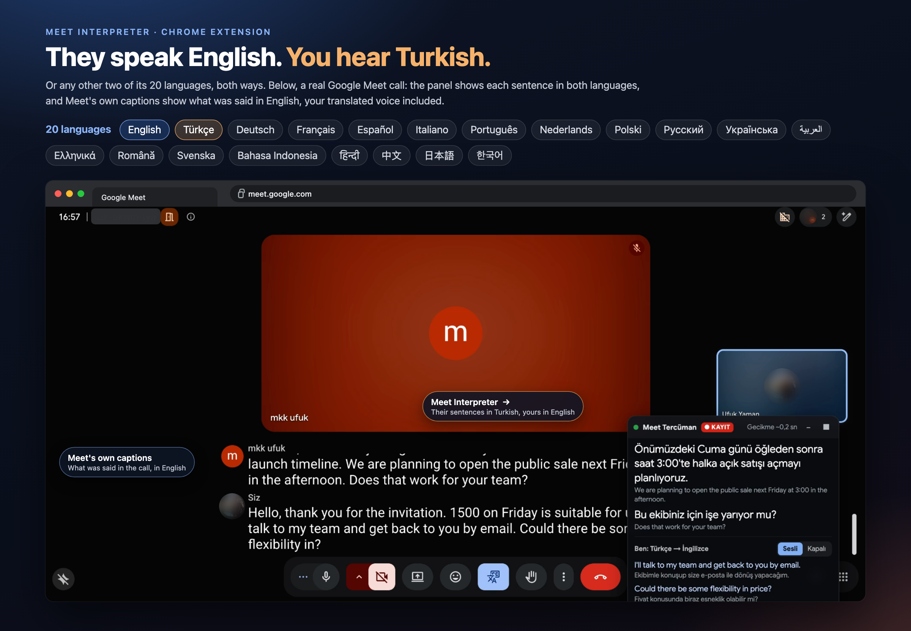

<div align="center">

# Meet Interpreter

### Live two-way speech translation for Google Meet

Any two of 20 languages, both ways. They speak English and you hear Turkish; you speak Turkish and they hear English, in your own voice. A Chrome extension with no backend: the keys stay in your browser.

<table>
  <tr><td><b>Languages</b></td><td>20, any two of them; English and Turkish by default</td></tr>
  <tr><td><b>Modes</b></td><td>Voice, subtitles only or off, for each direction</td></tr>
  <tr><td><b>Delay</b></td><td>About 1.2 s after each sentence, measured with the real services; Meet's own delay comes on top</td></tr>
  <tr><td><b>Backend</b></td><td>None</td></tr>
  <tr><td><b>Interface</b></td><td>English or Turkish</td></tr>
</table>

<br>



</div>

---

## Features

- Twenty languages, any two of them in either direction: English, Turkish, German, French, Spanish, Italian, Portuguese, Dutch, Polish, Russian, Ukrainian, Arabic, Greek, Romanian, Swedish, Indonesian, Hindi, Chinese, Japanese and Korean.
- Listens to the call through Chrome tab capture and to you through your microphone, transcribes both sides with ElevenLabs Scribe v2 Realtime, translates with Claude (or for free, see below) and speaks the result with ElevenLabs v4 Turbo, which keeps a natural pace and starts as fast as the older Flash v2.5. Each sentence goes to the voice with the one before it (and after it, when known), so the intonation carries on between sentences.
- Your translated voice goes into the call in place of your microphone. Meet keeps working as usual, and muting in Meet stops everything that would reach the call.
- A mode for each direction: spoken translation, subtitles only (no speech credits used) or off, switchable mid-call from the popup or the panel on the page.
- In voice mode you hear only the translation; their own voice is muted. In subtitles-only mode and with translation off you hear them normally.
- Subtitles like a film's, low in the Meet window above Meet's controls: only the translation, in large type, unless the settings ask for their own words under it. While they are still talking, a dimmed draft of their words so far, translated on your computer by Chrome's own translator (free, whichever translation the call uses), stands where the sentence's translation will come. Each line stays long enough to read, at most two at a time. They move above Meet's own captions when those are on, and never take a click.
- Your own voice clone, recorded on the settings page. The other person's voice is cloned only after you confirm they agreed, and the clone is deleted when the call ends.
- A panel with both sides' subtitles, the mode switches, the live delay and a usage counter with an estimated cost. It starts as a small button low on the left of the Meet window, opens with a click and can be dragged anywhere. A mark on the button shows when there is a warning to read.
- Optional call recording: the Meet tab's picture with both sides' audio, saved as MP4 on this computer only.
- Echo guard, a speaker mode for calls without headphones, automatic reconnects, and Meet's microphone followed automatically.
- Leaving the call, or leaving Meet in the same tab, ends the translation by itself, so nothing keeps listening or billing. If it stops because of an error (a used-up quota, for example), the panel stays open and says why.
- Settings changed mid-call apply at once, the call languages included. A service that stops answering is given up after a few seconds, so one stuck sentence never holds up the ones after it.

> **Read this first.**
> - The translated voice starts about 1.2 s after a sentence ends (measured with the real services, Meet's own delay on top; 1.5 s before version 1.1). Most of it is the wait for silence: the extension watches the sound level itself and closes a sentence after 0.7 s of silence, or sooner when the words so far read as a finished sentence. Speech recognition's own silence detection answered about 0.4 s later, so it is not used. In a long turn, finished sentences are translated while the speaker keeps going. Settings can shorten the wait to 0.5 s (about 1 s in all), at the cost of a long sentence being split now and then.
> - Free translation through Chrome's built-in translator is literal: "saat üç" comes out as "15.00 on Friday". Everyday meeting phrases are put in plain words first, but a free DeepL key or Claude gives natural sentences.
> - Two Meet participants on the same computer garble each other's audio, because Meet's adaptive audio and Chrome's echo cancellation treat them as one room. Test with a second device or a second person.
> - Tested in real Meet calls with two and three participants, and automatically in Chromium against a mock Meet call. Meet's page changes over time, so try a call before an important meeting.
> - Group calls work: in a test call with three English speakers taking turns (the real speech services, a stand-in Meet page) each one was translated in order. Every remote voice comes through one translation voice, and when two people talk at the same time usually only one of them is caught.
> - Cloning someone's voice needs their consent, under ElevenLabs' terms and data protection law.

---

## How it works

```text
Meet tab audio  -> Scribe (their language) -> Claude or free -> ElevenLabs -> your headphones and the subtitle bar
your microphone -> Scribe (your language)  -> Claude or free -> ElevenLabs -> the call, in place of your mic
```

---

## Free translation

Choose **Free** as the translation model in the settings and no Anthropic key is needed. The extension tries free services from the best quality down and moves to the next one by itself when a service runs out of quota, hits a rate limit, is slow or fails.

| Order | Service | Free allowance | Needs |
| --- | --- | --- | --- |
| 1 | DeepL API Free | 500,000 characters a month | Your free DeepL key |
| 2 | Mistral (`mistral-medium-latest`) | Free plan with rate limits | Your free Mistral key |
| 3 | Groq `openai/gpt-oss-120b` | Daily request and token limits | Your free Groq key |
| 4 | Groq `qwen/qwen3.8-27b` | Its own daily limits | The same Groq key |
| 5 | Chrome's built-in translator | No limit, runs on your computer | Chrome 138 or newer on desktop |

---

## Requirements

- Chrome 116 or newer (or another Chromium browser); 138 or newer for free translation without keys
- Node.js 18 or newer, only to build from source
- An ElevenLabs API key (voice cloning needs a paid plan), and an Anthropic API key unless you choose free translation
- Headphones

---

## Install

1. Download from the latest release and unzip it.
2. Open `chrome://extensions`, turn on Developer mode, choose **Load unpacked** and pick the unzipped `meet-interpreter` folder.
3. The settings page opens by itself. The rest is in the step-by-step guide: [SETUP.md](SETUP.md) (Turkish: [SETUP.tr.md](SETUP.tr.md)).

---

## Run Locally

```bash
git clone https://github.com/CuriQusEth/meet-interpreter.git
cd meet-interpreter
npm install
npm run build
```

Open `chrome://extensions`, turn on Developer mode, choose **Load unpacked** and pick the `dist` folder.

---

## License

[MIT](LICENSE)
